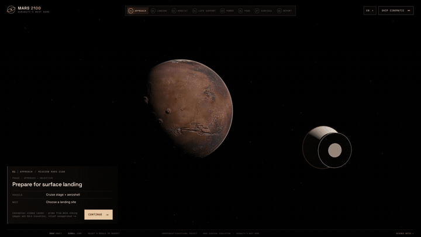
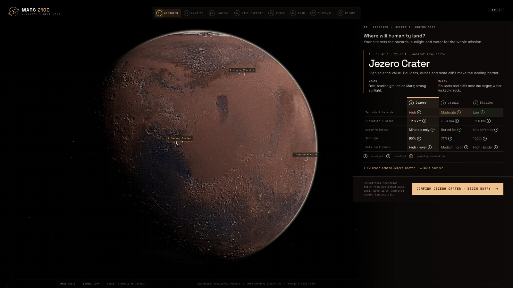
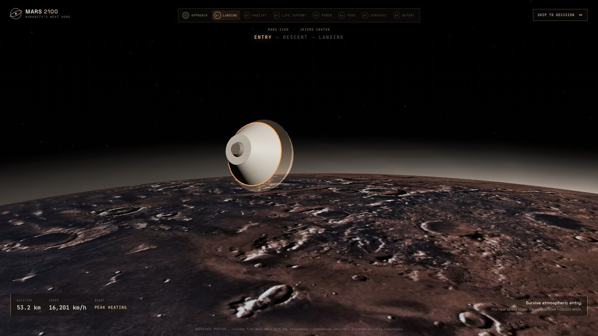
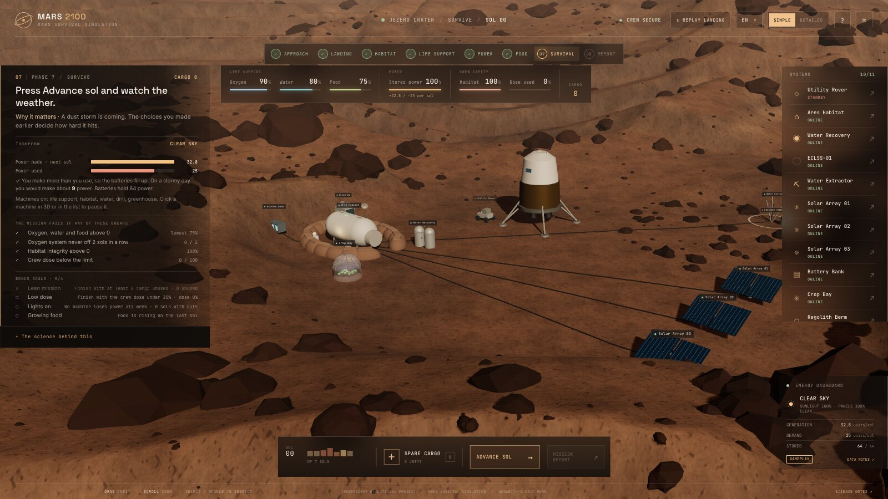
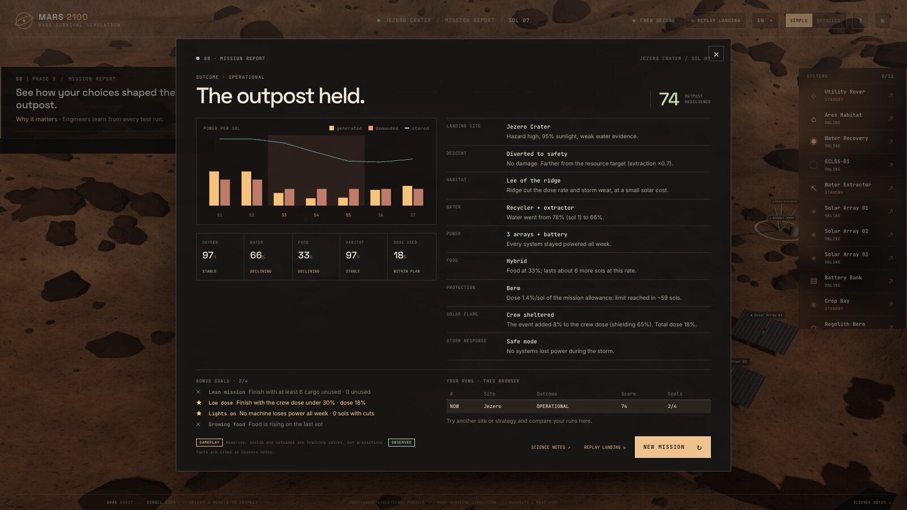

# MARS 2100: Humanity's Next Home

**An independent interactive Mars exploration and settlement survival simulator.**

Choose a landing site, fly the entry, descent and landing, then keep a small outpost alive through a Martian dust storm. 
An independent educational and portfolio project. Not affiliated with, sponsored by or endorsed by NASA or USGS; their public data is credited below.

**[▶ Play it in your browser](https://rasidi3112.github.io/mars-2100/)**

Recorded from the app, sped up about 2×. The globe uses NASA Viking colour and MOLA elevation data.

| Choose a landing site | Enter the atmosphere |
|:---:|:---:|
|  |  |
| **Build and run the outpost** | **Read the mission report** |
|  |  |

## Run the simulator

Install dependencies with `npm install`, then run `npm run dev` and open the local address Vite prints. For a production build, run `npm run build`. Every push to `main` is built and published to GitHub Pages by `.github/workflows/deploy.yml`.

## Mission journey

`APPROACH → LANDING → HABITAT → LIFE SUPPORT → POWER → FOOD → SURVIVAL → REPORT`

1. **Approach.** The spacecraft (cruise stage + aeroshell) closes on Mars. Continue or skip the cinematic.
2. **Site selection.** Compare Jezero Crater, Utopia Planitia and Elysium Planitia: hazards, elevation, water evidence, sunlight and data confidence, each tagged OBSERVED / MODELLED / GAMEPLAY.
3. **Entry.** The capsule enters with a restrained heat-shield glow. Altitude and speed readouts follow a rounded Mars 2020 reference profile.
4. **Descent.** The parachute opens, the heat shield drops away, then the backshell separates. Terrain-relative navigation finds boulders, and you choose: **divert to a safe zone**, or **hold course to the resource target**.
5. **Touchdown.** Powered descent raises a widening dust cloud. The legs compress, the engines cut off, the dust settles, and the lander stays put.
6. **Settlement phases.** Initial assessment, then the habitat site, life support, power, food, and protection. Each phase reveals only the controls it needs and spends limited cargo.
7. **Survival.** Advance sols. A regional dust storm arrives after sol 2. Choose safe mode, rover panel cleaning, or keeping everything running. If power runs out, systems are shed in priority order: the greenhouse goes first, the habitat lights go dark, and ECLSS is protected last.
8. **Report.** A per-sol power chart and a decision → consequence breakdown.

You can skip or replay the landing at any time. A replay never changes the outpost.

**For young learners.** A SIMPLE / DETAILED switch in the top bar changes the reading level. SIMPLE is the default and uses everyday words. DETAILED shows the technical wording. Both modes use the same numbers and rules. The help panel (`?`) includes a "Words to know" glossary.

**Bonus goals and replay value.** Four optional goals (Lean mission, Low dose, Lights on, Growing food) are shown while planning and tracked live during survival. The report scores them and lists your last runs in this browser, with a "New personal best" badge. Run history is kept in local browser storage only. The game works the same if storage is blocked.

## Languages

The interface is available in 15 languages. Pick one with the language button in the top bar. The choice is remembered in this browser; the first visit follows the browser language and falls back to English. Arabic is shown right to left.

- `src/i18n/locales/en.ts` is the source text. Every other file in `src/i18n/locales/` must provide the same keys.
- `src/i18n/glossary.md` lists the locked terms and rules (numbers, units and mission names never change).
- `src/i18n/REVIEW.md` tracks review status. **All translations still need review by a native speaker.**
- `npm run i18n:check` checks every translation against English. It looks for missing or extra keys, changed `{placeholders}`, missing or added numbers, translated mission names, lost spaces, missing plural forms and duplicate evidence letters. It exits with an error when something is wrong. Use `npm run i18n:check -- de ar` for some languages only, and `-- --counters` to list digits added by Chinese/Japanese/Korean counters. Needs Node 22.18 or newer.
- **Pseudo-locales (development only).** In `npm run dev` the language list also shows *Pseudo (test)* and *Pseudo RTL (test)*. The first adds accents, brackets and about 40% extra length, so untranslated text and cut-off labels stand out. The second writes English in Arabic letters, right to left, to check the mirrored layout. They are not included in production builds.

To add a language: create `src/i18n/locales/<code>.ts`, add it to `LOCALES` and `LOADERS` in `src/i18n/registry.ts`, add a row to `REVIEW.md`, then run `npm run i18n:check`.

## Architecture

- `src/mission/landingMachine.ts`: an explicit landing state machine (`APPROACH → SITE_SELECT → ENTRY → DESCENT → TOUCHDOWN → POST_LANDING → SETTLEMENT`). Invalid or duplicate events are ignored, and scene completion events carry a run id, so stages cannot be skipped or double-fired.
- `src/mission/settlement.ts`: phase reducer and per-sol simulation (generation vs demand, storage, load shedding, storm, emergency cache, projections).
- `src/mission/sites.ts`, `src/mission/edl.ts`, `src/mission/phases.ts`: site data, the EDL reference profile, and the guided copy for each phase.
- `src/WorldScene.tsx` + `src/scene/*`: the React Three Fiber scenes. These include the globe (NASA Viking colour and MOLA relief), entry, parachute and backshell, the legged lander, plume-driven dust, the procedural site-specific terrain, and the outpost models whose lights and states follow the simulation.
- `src/hud/*`: the timeline, landing HUD, phase panel, report and science notes.

The scene honours `prefers-reduced-motion`: it drops camera shake and uses faster transitions.

## Science notes

The in-app notes separate **OBSERVED** NASA results, **MODELLED** simplifications and **GAMEPLAY** assumptions.

- The landing-site terrain is procedural. Its colours and shapes take cues from rover panoramas, but it is not a reconstruction of a real location and uses no MOLA or HiRISE elevation data.
- The globe uses real, public-domain data: the USGS/NASA Ames Viking MDIM 2.1 colourised global mosaic for colour, and MGS MOLA MEGDR topography (16 px/degree) for relief shading, with slopes exaggerated ×4 so craters and volcanoes show on a small globe. Phones load 2048 × 1024 maps, larger screens 4096 × 2048 (`public/textures/mars/`). `node scripts/build-mars-textures.mjs` rebuilds them from the source files; the site markers sit at their real coordinates on this map.
- During entry, a sharper patch of the same data covers ±12° around the chosen site: the Viking colour mosaic cropped from the USGS map service (≈0.7 km/pixel; 1.4 km on phones) and MOLA relief at 64 px/degree, with the same ×4 slope exaggeration. Its edges fade into the globe, and only the chosen site's patch is downloaded. `node scripts/build-site-patches.mjs --urls` lists the source requests; `node scripts/build-site-patches.mjs <crops> <megt90n000gb.img> <megt00n000gb.img>` rebuilds the patches.
- The vehicle is conceptual. Its EDL sequence (heat shield → parachute → powered descent → legs) follows Phoenix (2008) and InSight (2018). The readouts are rounded from Perseverance milestones, and the 3D altitude is compressed.
- Site sunlight is modelled as cos(latitude). Reserves, cargo, yields, damage and storm timing are training values.
- This is an independent project. It is not affiliated with or endorsed by NASA or USGS and is not an official mission design.

Sources:

- [NASA Science: Mars facts](https://science.nasa.gov/mars/facts/)
- [NASA/NSSDC: Mars fact sheet](https://nssdc.gsfc.nasa.gov/planetary/factsheet/marsfact.html)
- [NASA PDS: MOLA MEGDR topography archive](https://pds-geosciences.wustl.edu/missions/mgs/megdr.html)
- [USGS Astrogeology: Mars Viking colorized global mosaic](https://astrogeology.usgs.gov/search/map/mars_viking_colorized_global_mosaic_232m)
- [NASA: Perseverance parachute deployment](https://science.nasa.gov/resource/perseverance-deploys-its-parachute-illustration/)
- [NASA: Terrain Relative Navigation](https://www.nasa.gov/directorates/stmd/impact-story-terrain-relative-navigation/)
- [NASA/JPL: Jezero hazard map](https://www.jpl.nasa.gov/images/jezeros-hazard-map)
- [NASA: Jezero crater elevation graph](https://science.nasa.gov/photojournal/jezero-crater-elevation-graph/)
- [NASA/JPL: InSight landing site](https://www.jpl.nasa.gov/news/press_kits/insight/landing/mission/landing-site)
- [NASA/JPL: Utopia Planitia buried ice (SHARAD)](https://www.jpl.nasa.gov/news/mars-ice-deposit-holds-as-much-water-as-lake-superior/)
- [NASA: ISS water recovery milestone](https://www.nasa.gov/missions/station/iss-research/nasa-achieves-water-recovery-milestone-on-international-space-station/)
- [NASA/JPL: MOXIE completes its mission](https://www.jpl.nasa.gov/news/nasas-oxygen-generating-experiment-moxie-completes-mars-mission/)
- [NASA: KRUSTY fission power test](https://www.nasa.gov/news-release/demonstration-proves-nuclear-fission-system-can-provide-space-exploration-power/)
- [NASA Science: Dust storms and safe mode](https://science.nasa.gov/resource/mars-report-dust-storms-on-mars/)

## License

The code is released under the [MIT License](LICENSE). The Mars globe and site textures in `public/textures/mars/` are derived from public-domain NASA and USGS data (see Sources above).
