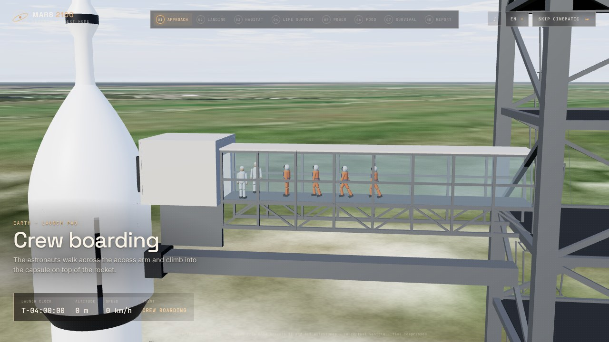
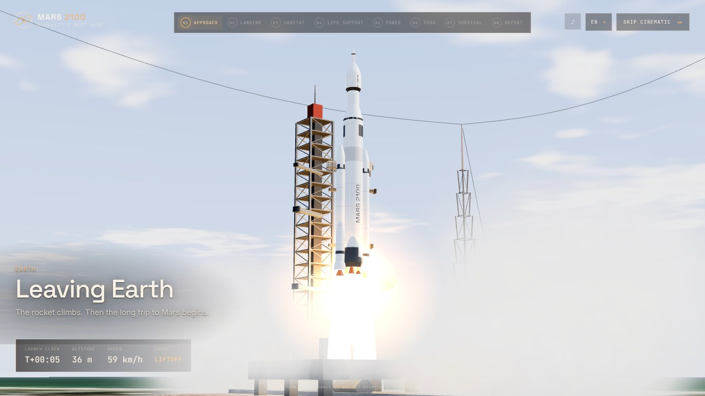
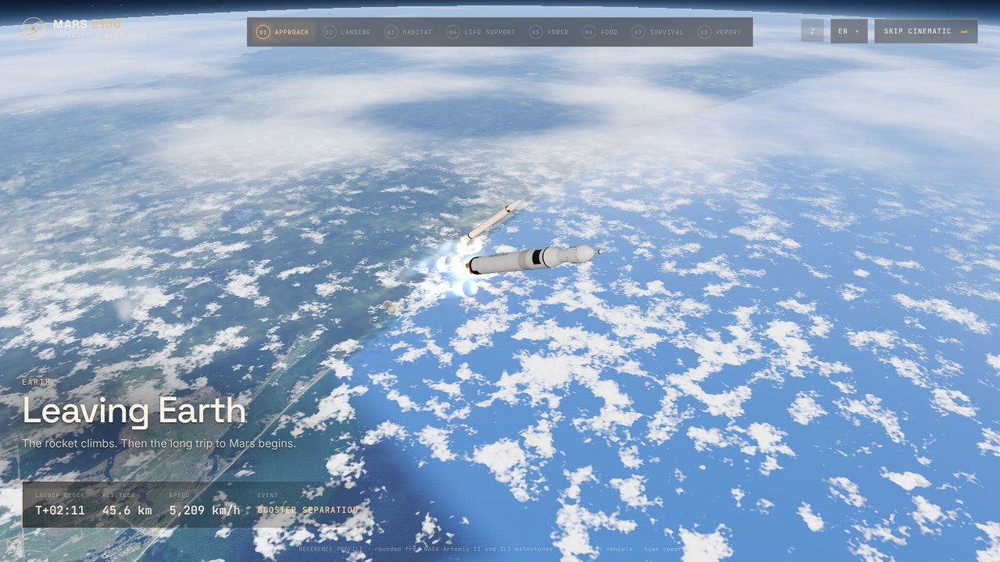
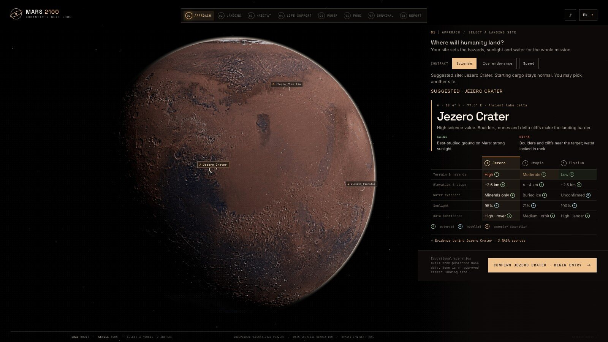
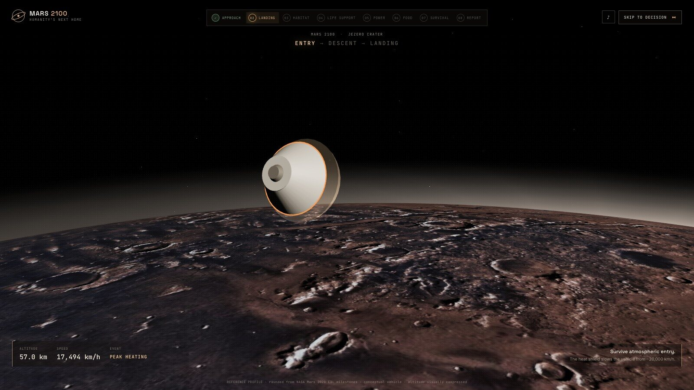
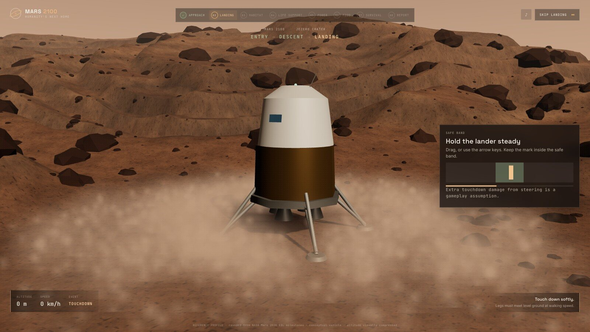
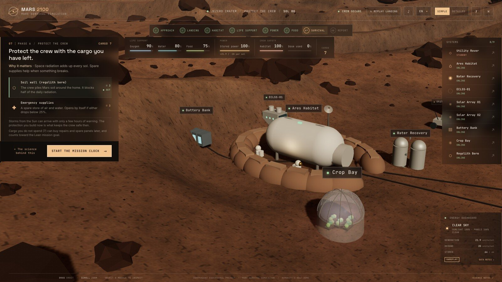
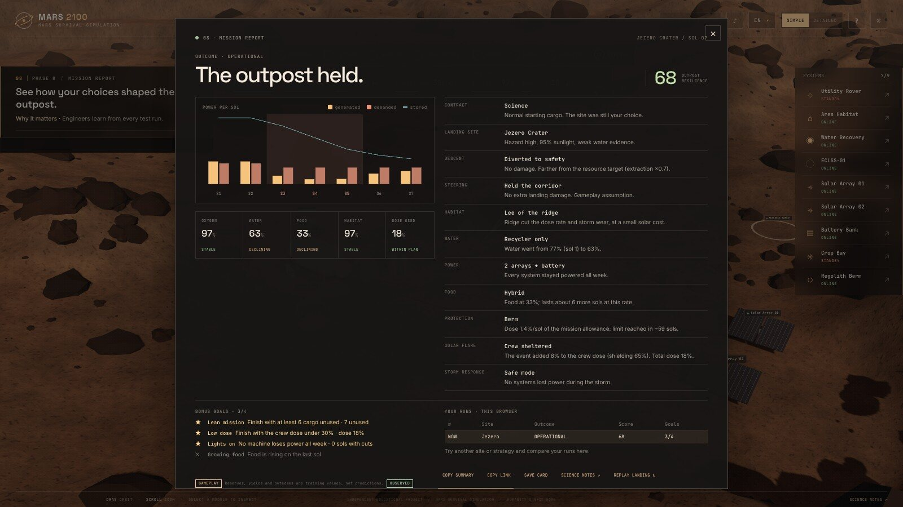

# MARS 2100: Humanity's Next Home

**An independent interactive Mars exploration and settlement survival simulator.**

Board the rocket on Earth, launch over the real Florida coast, choose a landing site, fly the entry, descent and landing, then keep a small outpost alive through a Martian dust storm. 
An independent educational and portfolio project. Not affiliated with, sponsored by or endorsed by NASA or USGS; their public data is credited below.

**[▶ Play it in your browser](https://rasidi3112.github.io/mars-2100/)**

Frames captured from the app. Earth uses NASA Blue Marble, Black Marble, VIIRS and Landsat imagery; the Mars globe uses NASA Viking colour and MOLA elevation data. The rocket, the tower and the crew are conceptual.

| Board on Earth | Lift off |
|:---:|:---:|
|  |  |
| **Leave Earth** | **Choose a landing site** |
|  |  |
| **Enter the atmosphere** | **Touch down** |
|  |  |
| **Build and run the outpost** | **Read the mission report** |
|  |  |

## Run the simulator

Install dependencies with `npm install`, then run `npm run dev` and open the local address Vite prints. For a production build, run `npm run build`. Every push to `main` is built and published to GitHub Pages by `.github/workflows/deploy.yml`.

## Phones, tablets and desktops

The simulator runs in any current browser with WebGL 2, with touch, mouse or keyboard.

- **Layout.** Phones held upright get their own layout (panels at the bottom, larger touch targets). A phone held sideways, or any window shorter than 540 px, gets the full layout drawn smaller, so nothing is cut off. Screens of 2400 × 1300 px and larger get it drawn larger, so text stays readable.
- **Speed.** The render resolution follows the frame rate: it steps down when frames take too long (older phones, integrated graphics) and back up when there is headroom. Small screens also load smaller textures (1–2 K instead of 2–4 K), fewer smoke puffs and a lighter cloud shader.
- **Install.** The page has a web app manifest, so a phone or tablet can add it to the home screen and open it full screen. It still needs a connection to load; there is no offline mode.
- **Motion.** With the system setting *reduce motion*, the launch film becomes three still pictures, camera shake is off and the steering check is skipped.

Layout and rendering were checked in headless Chromium (software rendering) at phone (390 × 844, 844 × 390 and 740 × 360), tablet (820 × 1180) and desktop sizes. They were not tested in Safari, in Firefox or on real devices, and frame rates on real phones were not measured.

## Mission journey

`APPROACH → LANDING → HABITAT → LIFE SUPPORT → POWER → FOOD → SURVIVAL → REPORT`

1. **Launch and approach.** The film opens at the pad, where NASA's Launch Complex 39B stands on the Florida coast:
   - **Crew boarding.** Four astronauts in orange pressure suits walk the crew access arm from the tower to the White Room and board the capsule through its side hatch.
   - **Arm retract and countdown.** The access arm swings away (T−8 min). The main engines start at T−6.36 s, water floods the flame trench, and the boosters ignite at T−0.
   - **Ascent.** The rocket clears the tower, rolls and pitches east over the Atlantic, passes maximum dynamic pressure, drops its two boosters (+2:08, about 43 km up), throws off its abort tower and service-module panels (+3:18), cuts off its main engines (+8:06) and separates from the upper stage (+8:18) more than 160 km up. A launch clock, altitude, speed and the current event run in the corner.
   - **Cruise.** Earth falls behind on a shortened cruise, then the spacecraft (capsule + service module) closes on Mars. Continue or skip the film at any time.
2. **Site selection.** Pick a mission contract (Science, Ice endurance or Speed). It suggests a site and changes only the starting cargo, water and food. Then compare Jezero Crater, Utopia Planitia and Elysium Planitia: hazards, elevation, water evidence, sunlight and data confidence, each tagged OBSERVED / MODELLED / GAMEPLAY.
3. **Entry.** The capsule enters with a restrained heat-shield glow. Altitude and speed readouts follow a rounded Mars 2020 reference profile.
4. **Descent.** The parachute opens, the heat shield drops away, then the backshell separates. Terrain-relative navigation finds boulders, and you choose: **divert to a safe zone**, or **hold course to the resource target**.
5. **Touchdown.** Powered descent raises a widening dust cloud. For eight seconds, hold the lander steady inside the safe band against the gusts (drag, or use the arrow keys). Drifting out of the band costs habitat integrity and some cargo. The legs compress, the engines cut off, the dust settles, and the lander stays put.
6. **Settlement phases.** Initial assessment, then the habitat site, life support, power, food, and protection. Each phase reveals only the controls it needs and spends limited cargo.
7. **Survival.** Advance sols. A regional dust storm arrives after sol 2. Choose safe mode, rover panel cleaning, or keeping everything running. Dust drifts across the outpost, and a rover cleaning the panels circles the arrays. If power runs out, systems are shed in priority order: the greenhouse goes first, the habitat lights go dark, and ECLSS is protected last. Later, a solar particle event raises the radiation dose: keep the crew inside, or keep working outside. The shielding you built earlier decides how much the crew gets.
8. **Report.** A per-sol power chart and a decision → consequence breakdown. Copy a text summary, copy a share link, or save the result as a PNG card. A shared link opens a read-only card of the finished run. The result is stored in the link itself, so nothing is sent to a server.

You can skip or replay the landing at any time. A replay never changes the outpost.

**For young learners.** A SIMPLE / DETAILED switch in the top bar changes the reading level. SIMPLE is the default and uses everyday words. DETAILED shows the technical wording. Both modes use the same numbers and rules. The help panel (`?`) includes a "Words to know" glossary.

**Sound.** A small soundtrack and sound effects are generated in the browser with the Web Audio API, so there are no audio files. Sound starts after your first click or key press. The ♪ button mutes it, and the choice is remembered in this browser.

**Bonus goals and replay value.** Four optional goals (Lean mission, Low dose, Lights on, Growing food) are shown while planning and tracked live during survival. The report scores them and lists your last runs in this browser, with a "New personal best" badge. Run history is kept in local browser storage only. The game works the same if storage is blocked.

## Languages

The interface is available in 15 languages. Pick one with the language button in the top bar. The choice is remembered in this browser; the first visit follows the browser language and falls back to English. Arabic is shown right to left.

- `src/i18n/locales/en.ts` is the source text. Every other file in `src/i18n/locales/` must provide the same keys.
- `src/i18n/glossary.md` lists the locked terms and rules (numbers, units and mission names never change).
- `src/i18n/REVIEW.md` tracks review status. **All translations still need review by a native speaker.**
- `npm run i18n:check` checks every translation against English. It looks for missing or extra keys, changed `{placeholders}`, missing or added numbers, translated mission names, lost spaces, missing plural forms and duplicate evidence letters. It exits with an error when something is wrong. Use `npm run i18n:check -- de ar` for some languages only, and `-- --counters` to list digits added by Chinese/Japanese/Korean counters. Needs Node 22.18 or newer.
- **Pseudo-locales (development only).** In `npm run dev` the language list also shows *Pseudo (test)* and *Pseudo RTL (test)*. The first adds accents, brackets and about 40% extra length, so untranslated text and cut-off labels stand out. The second writes English in Arabic letters, right to left, to check the mirrored layout. They are not included in production builds.

To add a language: create `src/i18n/locales/<code>.ts`, add it to `LOCALES` and `LOADERS` in `src/i18n/registry.ts`, add a row to `REVIEW.md`, then run `npm run i18n:check`.

## Architecture

- `src/mission/landingMachine.ts`: an explicit landing state machine (`APPROACH → SITE_SELECT → ENTRY → DESCENT → TOUCHDOWN → POST_LANDING → SETTLEMENT`). Invalid or duplicate events are ignored, and scene completion events carry a run id, so stages cannot be skipped or double-fired.
- `src/mission/settlement.ts`: phase reducer and per-sol simulation (generation vs demand, storage, load shedding, storm, emergency cache, projections).
- `src/mission/sites.ts`, `src/mission/edl.ts`, `src/mission/phases.ts`: site data, the EDL reference profile, and the guided copy for each phase.
- `src/mission/contracts.ts`, `src/mission/steer.ts`, `src/mission/share.ts`: the three mission contracts, the touchdown steering check, and the encoding of share links.
- `src/mission/launch.ts`: the launch timeline and the reference ascent profile (clock, altitude, speed, downrange distance, pitch and event for every moment of the film).
- `src/WorldScene.tsx` + `src/scene/*`: the React Three Fiber scenes. `src/scene/LaunchSite.tsx` directs the Earth launch at real scale (1 unit = 1 m, Earth's real radius): one shader traces each view ray against the curved ground, the cloud deck and the sky, and colours the ground from nested NASA maps. `src/scene/LaunchVehicle.tsx` is the rocket and its staging, `src/scene/LaunchPad.tsx` the pad, tower, access arm and crew, and `src/scene/earthData.ts` loads the Earth imagery. `src/scene/EarthLaunch.tsx` is the Earth globe seen during the cruise. The rest include the Mars globe (NASA Viking colour and MOLA relief), entry, parachute and backshell, the legged lander, plume-driven dust, the procedural site-specific terrain, and the outpost models whose lights and states follow the simulation.
- `src/audio/missionAudio.ts`: the Web Audio soundtrack and sound cues.
- `src/hud/*`: the timeline, launch clock, landing HUD, steering pad, contract picker, phase panel, report, share card and science notes. `src/hud/uiScale.ts` scales the layout for short and very large windows.

The scene honours `prefers-reduced-motion`: it drops camera shake, uses faster transitions, shows the launch as three still pictures, and skips the steering check.

Two development-only switches help with checks and screenshots (they do nothing in a production build): `?launch=<seconds>` runs the launch film up to that story second and freezes it there, `?film=<seconds>` starts the opening film at that second, `?fullres` turns off the adaptive resolution, and `?capture` stops the render loop so a script can step it frame by frame with `window.captureStep(dt)` (used to record the promo video).

## Science notes

The in-app notes separate **OBSERVED** NASA results, **MODELLED** simplifications and **GAMEPLAY** assumptions.

- **Earth is drawn from NASA imagery**, all taken from NASA's Global Imagery Browse Services (GIBS) by `scripts/build-earth-textures.py`:
  - *Launch coast:* the Landsat 7 WELD composite for 2000 (NASA/USGS, 30 m) in a 44 km box around Launch Complex 39B (28.6272° N, 80.6208° W), then Blue Marble: Next Generation with shaded relief and bathymetry (500 m) for Florida and the western Atlantic.
  - *Globe:* Blue Marble for the day side, the Black Marble 2016 composite for city lights on the night side, and cloud cover taken from one real day (20 March 2021) of VIIRS true-colour imagery from the Suomi NPP satellite. The cloud map keeps only the bright, colourless pixels of that image, so it is **MODELLED** from an observed day: snow and ice can read as cloud, and thin cloud can be missed.
  - Phones load 1–2 K maps, larger screens 2–4 K (`public/textures/earth/`). `python3 scripts/build-earth-textures.py` downloads the source images again and rebuilds every file (needs Python 3 with Pillow and numpy, and access to `gibs.earthdata.nasa.gov`).
- **The launch is drawn at real scale.** One scene unit is one metre, the planet has Earth's mean radius (6,371 km), and the rocket climbs to its real altitude, so the horizon curves by the right amount. Only time is compressed: about eight minutes of ascent play in about 30 seconds.
- **Countdown and ascent follow NASA reference points**, rounded:

  | Event | Time | Reference value | Source |
  |---|---|---|---|
  | Crew boards through the White Room | about 4 h before launch | — | Artemis II press kit |
  | Crew access arm retracts | T−8 min | — | Artemis II press kit |
  | Main engines start | T−6.36 s | — | Artemis II launch day updates |
  | Tower clear, roll and pitch | +0:09 | — | Artemis II press kit |
  | Supersonic | +0:56 | — | Artemis II press kit |
  | Maximum dynamic pressure | +1:10 | — | Artemis II press kit |
  | Booster separation | +2:08 | 43.3 km, Mach 4.3 | Artemis II press kit; SLS Reference Guide |
  | Abort system jettison | +3:18 | — | Artemis II press kit |
  | Main engine cutoff | +8:06 | 28,003 km/h | Artemis II press kit; SLS Reference Guide |
  | Stage separation | +8:18 | more than 161.5 km | Artemis II press kit; SLS Reference Guide |

  Everything between those points is **MODELLED**: altitude and speed are interpolated, and the downrange distance, the pitch angle and the speed in km/h at booster separation (Mach 4.3 taken as about 5,000 km/h) are estimates. It is a reference profile, not a flight trajectory.
- **The vehicle, the tower and the crew are GAMEPLAY stand-ins.** The rocket has the layout and size class of NASA's Space Launch System (98 m tall, an 8.4 m core, two 54 m boosters, an abort tower over the capsule) so the sequence reads correctly, but its design and markings are invented. The pad structures are approximate shapes, not models of the real ones. The sky, the sea glint, the haze, the cloud deck over the launch coast and the ground detail finer than the 30 m imagery are drawn by a shader.
- The landing-site terrain is procedural. Its colours and shapes take cues from rover panoramas, but it is not a reconstruction of a real location and uses no MOLA or HiRISE elevation data.
- The globe uses real, public-domain data: the USGS/NASA Ames Viking MDIM 2.1 colourised global mosaic for colour, and MGS MOLA MEGDR topography (16 px/degree) for relief shading, with slopes exaggerated ×4 so craters and volcanoes show on a small globe. Phones load 2048 × 1024 maps, larger screens 4096 × 2048 (`public/textures/mars/`). `node scripts/build-mars-textures.mjs` rebuilds them from the source files; the site markers sit at their real coordinates on this map.
- During entry, a sharper patch of the same data covers ±12° around the chosen site: the Viking colour mosaic cropped from the USGS map service (≈0.7 km/pixel; 1.4 km on phones) and MOLA relief at 64 px/degree, with the same ×4 slope exaggeration. Its edges fade into the globe, and only the chosen site's patch is downloaded. `node scripts/build-site-patches.mjs --urls` lists the source requests; `node scripts/build-site-patches.mjs <crops> <megt90n000gb.img> <megt00n000gb.img>` rebuilds the patches.
- The spacecraft is conceptual. The capsule rides apex-up on the rocket with its service module against the heat shield, as on Apollo and Orion, and casts the module off before entry. Its EDL sequence (heat shield → parachute → powered descent → legs) follows Phoenix (2008) and InSight (2018). The readouts are rounded from Perseverance milestones, and the 3D altitude is compressed.
- Site sunlight is modelled as cos(latitude). Reserves, cargo, yields, damage and storm timing are training values. The contracts, the steering check and its extra damage are gameplay assumptions.
- This is an independent project. It is not affiliated with or endorsed by NASA or USGS and is not an official mission design.

Sources:

- [NASA GIBS: Global Imagery Browse Services (API documentation)](https://nasa-gibs.github.io/gibs-api-docs/)
- [NASA Earth Observatory: Blue Marble](https://science.nasa.gov/earth/earth-observatory/collections/blue-marble/)
- [NASA: Artemis II press kit (countdown and ascent timeline)](https://www.nasa.gov/wp-content/uploads/2026/01/artemis-ii-press-kit.pdf)
- [NASA: Artemis II launch day updates](https://www.nasa.gov/blogs/missions/2026/04/01/live-artemis-ii-launch-day-updates/)
- [NASA: Space Launch System Reference Guide (2022)](https://www.nasa.gov/wp-content/uploads/2022/03/sls-reference-guide-2022-v2-508-0.pdf)
- [NASA Science: Mars facts](https://science.nasa.gov/mars/facts/)
- [NASA/NSSDC: Mars fact sheet](https://nssdc.gsfc.nasa.gov/planetary/factsheet/marsfact.html)
- [NASA PDS: MOLA MEGDR topography archive](https://pds-geosciences.wustl.edu/missions/mgs/megdr.html)
- [USGS Astrogeology: Mars Viking colorized global mosaic](https://astrogeology.usgs.gov/search/map/mars_viking_colorized_global_mosaic_232m)
- [NASA: Perseverance parachute deployment](https://science.nasa.gov/resource/perseverance-deploys-its-parachute-illustration/)
- [NASA: Terrain Relative Navigation](https://www.nasa.gov/directorates/stmd/impact-story-terrain-relative-navigation/)
- [NASA/JPL: Jezero hazard map](https://www.jpl.nasa.gov/images/jezeros-hazard-map)
- [NASA: Jezero crater elevation graph](https://science.nasa.gov/photojournal/jezero-crater-elevation-graph/)
- [NASA/JPL: InSight landing site](https://www.jpl.nasa.gov/news/press_kits/insight/landing/mission/landing-site)
- [NASA/JPL: Utopia Planitia buried ice (SHARAD)](https://www.jpl.nasa.gov/news/mars-ice-deposit-holds-as-much-water-as-lake-superior/)
- [NASA: ISS water recovery milestone](https://www.nasa.gov/missions/station/iss-research/nasa-achieves-water-recovery-milestone-on-international-space-station/)
- [NASA/JPL: MOXIE completes its mission](https://www.jpl.nasa.gov/news/nasas-oxygen-generating-experiment-moxie-completes-mars-mission/)
- [NASA: KRUSTY fission power test](https://www.nasa.gov/news-release/demonstration-proves-nuclear-fission-system-can-provide-space-exploration-power/)
- [NASA Science: Dust storms and safe mode](https://science.nasa.gov/resource/mars-report-dust-storms-on-mars/)

## License

The code is released under the [MIT License](LICENSE). The Mars globe and site textures in `public/textures/mars/` are derived from public-domain NASA and USGS data. The Earth textures in `public/textures/earth/` are derived from NASA GIBS imagery (Blue Marble, Black Marble, VIIRS and the NASA/USGS Landsat WELD composite; see Sources above). NASA asks that its imagery be credited, which this page and the in-app science notes do; using it does not mean NASA endorses this project.

Developed by [rasidi3112](https://github.com/rasidi3112).
